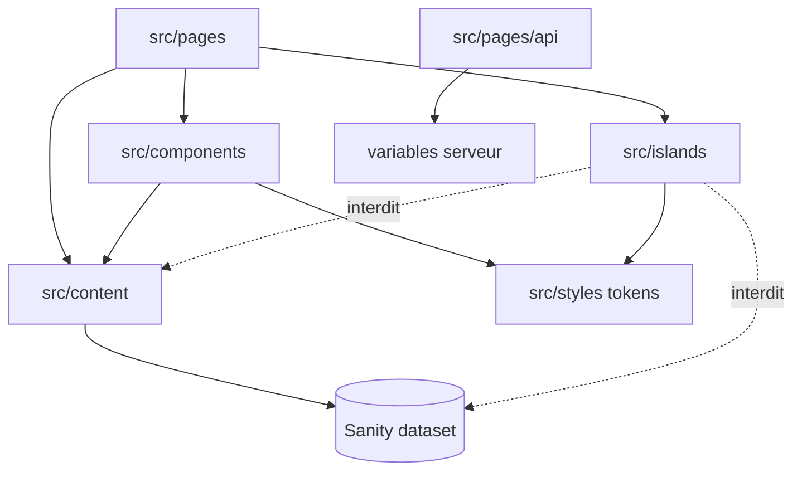
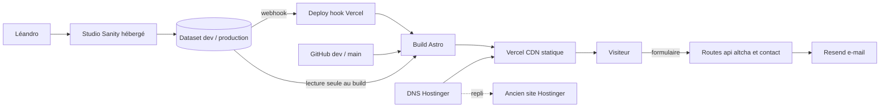

# Architecture Spine — Portfolio Léandro Da Silva (refonte)

## Design Paradigm

**Static-first islands over a build-time CMS.** Tout le contenu est lu dans Sanity au build, rendu en HTML complet, puis servi statique. Le JavaScript n'existe que sous forme d'îlots React isolés pour l'interactif. Une seule exception serveur : la route de contact.

| Couche | Dossier | Rôle |
| --- | --- | --- |
| Contenu | `src/content/` | Seule porte vers Sanity ; produit des view-models typés FR/EN |
| Pages | `src/pages/` | Routes, SEO, composition ; aucune requête Sanity directe |
| Composants statiques | `src/components/` | `.astro`, zéro JS client |
| Îlots | `src/islands/` | `.tsx` React, seule couche hydratée |
| Tokens/thèmes | `src/styles/` | Tokens CSS par Thème, source : `design-system/tokens.css` |
| Serveur | `src/pages/api/` | Les deux routes dynamiques, et seulement elles |
| Studio | `studio/` | Projet Sanity indépendant, hors build du Site |

## Invariants & Rules



### AD-1 — Rendu statique, JavaScript en îlots seulement [ADOPTED]

- **Binds:** FR-4, NFR-1, FR-8
- **Prevents:** une SPA rendue côté client ; du contenu qui n'existe qu'après exécution de JS
- **Rule:** toute page est du HTML complet au build. Un composant est `.astro` sauf s'il a besoin d'état ou d'événements du navigateur ; seul ce cas devient un îlot dans `src/islands/`. Le HTML de chaque page contient tout son texte sans JS.

### AD-2 — Sanity lu au build, par une seule couche [ADOPTED]

- **Binds:** FR-1, FR-2, FR-3, NFR-2
- **Prevents:** composants qui interrogent Sanity chacun à sa façon ; clé d'écriture exposée ; rendu dépendant de l'API au runtime
- **Rule:** seul `src/content/` importe le client Sanity, avec un jeton en **lecture seule**. Il expose des view-models typés ; pages et composants ne reçoivent que ces objets. Aucun appel Sanity au runtime ni depuis un îlot. Une publication dans le Studio déclenche un rebuild complet via webhook vers le deploy hook Vercel de l'Environnement correspondant.

### AD-3 — Aucun texte en dur, tout bilingue [ADOPTED]

- **Binds:** FR-1, FR-10, FR-2
- **Prevents:** un texte visible dans le code ; une langue incomplète en prod
- **Rule:** chaque texte visible vient de Sanity, y compris les textes d'interface (document singleton `uiStrings`) et les textes alternatifs. Tout champ de texte est un objet `{ fr, en }`. `src/content/` échoue le build si une valeur FR ou EN est vide ou si un `alt` d'image informative manque ; une image marquée « décorative » dans Sanity est exemptée et reçoit `alt=""`. Le Studio empêche de publier un document incomplet (validation dans le schéma). Le catalogue des clés de `uiStrings` est défini une fois dans `studio/` et ses types sont générés (`sanity typegen`) vers `src/content/types.ts` : schémas et view-models partagent ces types, il n'y a pas deux définitions écrites à la main. Les view-models sont **résolus par langue** : `src/content/` reçoit la locale de la route et renvoie des chaînes simples ; seul le sélecteur de Langue utilise les chemins `localizedPath`. Les chaînes du widget ALTCHA et de la page 404 viennent aussi de `uiStrings` ; il y a un `404` par Langue.

### AD-4 — Schéma d'adresses et page de Projet [ADOPTED]

- **Binds:** FR-6, FR-7, FR-10, FR-19
- **Prevents:** deux schémas d'URL ; une adresse de Projet qui n'affiche pas la fenêtre ; slugs divergents entre langues
- **Rule:** routes `/`, `/projets/[slug]`, `/en/`, `/en/projects/[slug]`. Le `slug` est unique et identique en FR et EN, défini dans Sanity, et immuable après la première publication en production (le schéma le verrouille). La Langue ne change jamais automatiquement : `/` reste en FR quel que soit le navigateur, et le sélecteur est le seul moyen de passer en EN. Une page de Projet est la Page d'accueil complète (même composition `HomePage`) rendue avec la Fenêtre de projet ouverte dans le HTML. Les anciennes adresses `/#work`, `/#journey`, `/#skills`, `/#contact` restent des ancres de la Page d'accueil ; ni elles ni les anciens liens ne sont listés dans `sitemap.xml`. Une adresse inconnue sert `404.html` au style du Site.

### AD-5 — Fenêtre de projet : HTML d'abord, îlot pour l'amélioration [ADOPTED]

- **Binds:** FR-6, FR-11, FR-22
- **Prevents:** une fenêtre qui n'existe que côté client ; un focus perdu ; un bouton « retour » cassé
- **Rule:** le contenu de la fenêtre est rendu en HTML. Un unique îlot `ProjectWindow` ajoute ouverture/fermeture sans rechargement via l'API History (`pushState`), le piège de focus, Échap, le retour du focus à la Carte d'origine, et le geste mobile. Le bouton « retour » du navigateur ferme la fenêtre. Le contenu de chaque Projet est servi par sa propre page : depuis la Page d'accueil, l'îlot récupère `/projets/[slug]` (ou son équivalent EN) et en extrait la fenêtre, sans inliner les cinq Projets dans chaque page. Un module unique `src/islands/overlay.ts` possède la pile des superpositions (fenêtre, galerie détaillée, menu mobile) : seul lui gère Échap, le piège de focus et le retour du focus ; fermer une page ouverte en arrivée directe ramène à `/` (ou `/en/`) par navigation, sinon par `history.back()`. Un helper partagé `localizedPath(locale, route, slug)` construit toute adresse ; personne n'en écrit une à la main. Les trois Gabarits sont trois composants `.astro` choisis par un champ `template` du Projet.

### AD-6 — Thèmes par attribut et tokens, rien en dur [ADOPTED]

- **Binds:** FR-8, FR-9, FR-20, FR-22
- **Prevents:** un composant qui code une couleur ou une ombre ; un flash du mauvais Thème ; un contraste cassé dans un Thème
- **Rule:** le Thème actif est l'attribut `data-theme` (`pop` par défaut, `terminal`, `wireframe`) sur `<html>`. Un petit script **externe** (`public/theme-init.js`, bloquant dans `<head>`, pas inline) le pose avant le premier rendu depuis `localStorage` (clé `portfolio:theme`). Les composants n'utilisent que des tokens sémantiques (variables CSS) exposés à Tailwind via `@theme inline` (nécessaire pour que les surcharges `[data-theme=…]` s'appliquent) ; aucune valeur de couleur, d'ombre ou de bordure littérale hors `src/styles/`. Chaque Token existe aussi en variable Figma de même nom.

### AD-7 — Budget JavaScript et animations [ADOPTED]

- **Binds:** NFR-1, FR-12, FR-13, SM-1
- **Prevents:** un bundle initial qui dérive ; Framer Motion tiré sur le chemin critique
- **Rule:** le JS initial est inférieur à 70 Ko compressés. Définition : somme du JavaScript transféré (brotli) pour charger la Page d'accueil FR sans interaction, îlots `client:visible` non encore visibles exclus, analytics exclu. Mesuré en CI, la PR échoue au-delà. Faisabilité avec React à prouver dès la première story ; si le seuil est intenable, l'alias `preact/compat` est l'unique repli autorisé, avant tout relèvement du seuil. Les îlots partagent leur état (Thème, Langue, son coupé, Mode fête) via un seul module `src/islands/prefs.ts` (store `nanostores`) qui est seul à lire/écrire `localStorage` ; aucun autre code n'y touche. Les îlots hydratent avec `client:visible` ou `client:idle`, jamais `client:load` sans justification écrite. Framer Motion est interdit dans le JS initial ; les animations de décor sont en CSS, et toute bibliothèque d'animation n'est chargée que dans l'îlot qui l'exige. Aucun contenu ne bouge seul plus de 5 secondes (le bandeau défilant n'est plus rendu sur le site actuel, `Marquee` et la clé `marquee` ne sont pas migrés) ; toute animation autonome ajoutée plus tard doit offrir une pause (FR-13).

### AD-8 — Une seule surface serveur : deux routes [ADOPTED]

- **Binds:** FR-15, FR-16, FR-21, NFR-5
- **Prevents:** du code serveur qui s'étend ; un secret côté client ; un envoi sans vérification
- **Rule:** seules `src/pages/api/altcha.ts` (émet un défi) et `src/pages/api/contact.ts` (valide le jeton ALTCHA, valide les champs, envoie via Resend) sont `prerender = false`. Toute autre route est statique. Les clés (secrets HMAC ALTCHA — altcha-lib v2 en utilise deux —, clé Resend) vivent dans les variables d'environnement Vercel, jamais dans le dépôt ni le code livré. La route ne répond jamais un succès sans jeton valide. Les défis ALTCHA expirent vite (durée courte, rejeu au-delà non stocké : limite acceptée sans base de données). L'API renvoie des **codes d'erreur stables par champ** (jamais du texte) ; l'îlot du formulaire les traduit avec les `uiStrings` reçus en props.

### AD-9 — Coordonnées non lisibles dans le code livré [ADOPTED]

- **Binds:** FR-16, SM-3
- **Prevents:** e-mail et téléphone en clair dans le HTML ou le JS
- **Rule:** exception explicite à AD-1 : e-mail et téléphone sont les seuls contenus absents du HTML sans JS. Ils sont stockés dans Sanity sous forme encodée (base64 en fragments) et assemblés par un îlot au chargement ; le texte affiché ne change pas, et sans JS le Visiteur voit un lien vers le Formulaire de contact. Un test CI vérifie qu'aucune des deux coordonnées n'apparaît en clair dans le HTML ni les bundles. Limite acceptée : ne protège pas contre les robots qui exécutent JS.

### AD-10 — Environnements, branches et contenu [ADOPTED]

- **Binds:** FR-3, NFR-2, NFR-3, NFR-5
- **Prevents:** du contenu non vérifié en prod ; un Site de dev indexé ou mesuré ; un dataset partagé
- **Rule:** `main` déploie la prod, `dev` déploie l'Environnement dev. Deux datasets Sanity : `dev` et `production` (le plan gratuit en permet deux). Le build lit le dataset donné par `SANITY_DATASET`. Le build produit selon `VERCEL_ENV` le `robots.txt` et `<meta name="robots">` (interdit sur dev), et `vercel.json` ajoute `X-Robots-Tag: noindex` par une règle conditionnée à l'hôte de dev. Le Site de dev ne charge pas l'analytics. Table : `main` → Production → dataset `production` → domaine final ; `dev` → Preview → dataset `dev` → alias stable ; PR de fonctionnalité → Preview → dataset `dev`. Le jeton Sanity de lecture de `dev` ne lit pas `production`. Le build lit les **documents publiés** uniquement (jamais les brouillons). La promotion du contenu dev → production est une opération explicite (export/import Sanity CLI), documentée dans le dépôt.

### AD-11 — En-têtes de sécurité déclarés dans le dépôt [ADOPTED]

- **Binds:** FR-21, SM-3
- **Prevents:** en-têtes oubliés ou modifiés hors revue ; CSP trop permissive
- **Rule:** tous les en-têtes (CSP, HSTS, `X-Content-Type-Options`, `Referrer-Policy`, `Permissions-Policy`, `frame-ancestors`) sont dans `vercel.json`, statique. La CSP vise `script-src 'self'` : aucun script inline écrit à la main (le script de Thème est un fichier, AD-6). `style-src 'self' 'unsafe-inline'` est toléré (attributs `style` des îlots), pas pour les scripts. Si l'hydratation d'Astro impose des scripts inline, la première story prototype tranche entre `security.csp` d'Astro (meta avec hashes, `frame-ancestors` restant dans `vercel.json`) et cette règle ; aucune autre dérogation. Un test CI échoue si un en-tête requis manque, et un test navigateur charge les pages sous la CSP réelle sans violation (scripts, styles, polices, médias, worker ALTCHA). HSTS : durée courte (au plus 1 jour) tant que la période de repli de AD-15 court, sans `preload` ni `includeSubDomains`, afin de ne pas casser le retour arrière DNS vers l'ancien site ; allongé seulement après la fin du repli. Les dépendances vulnérables sont surveillées par Dependabot et `npm audit` en CI.

### AD-12 — Images optimisées au build, hébergées avec le Site [ADOPTED]

- **Binds:** NFR-1, FR-1, FR-22
- **Prevents:** images servies par l'API Sanity au runtime ; images sans alt ; poids incontrôlé
- **Rule:** `src/content/` télécharge les assets Sanity au build et Astro les optimise (formats modernes, `srcset`, chargement différé hors écran). Le Site ne référence jamais l'URL CDN Sanity dans son HTML. Le schéma Sanity rend le texte alternatif obligatoire pour toute image informative et permet « décorative » explicite.

### AD-13 — Mesure d'audience et préférences sans cookie [ADOPTED]

- **Binds:** NFR-5, FR-9, FR-12
- **Prevents:** un cookie déposé ; une mesure sur le dev ; des clés de stockage dispersées
- **Rule:** la mesure est `@vercel/analytics`, chargée uniquement quand `VERCEL_ENV=production`. Les préférences du Visiteur vivent dans `localStorage` sous le préfixe `portfolio:` (`portfolio:theme`, `portfolio:muted`) ; aucun cookie. Le son est coupé par défaut.

### AD-14 — Qualité bloquante en CI [ADOPTED]

- **Binds:** NFR-3, FR-8, FR-22, SM-1, SM-2, SM-4
- **Prevents:** une régression d'accessibilité, de poids ou de fidélité fusionnée sans signal
- **Rule:** chaque PR lance : build, `astro check`, lint, tests d'accessibilité automatiques (axe) sur l'échantillon FR-22, Lighthouse, budget JS, vérification des en-têtes, et comparaison visuelle (3 Thèmes × 375/768/1440 px, animations figées, seuil 0,1 %) contre des captures de référence de l'ancien site stockées dans `tests/reference/`. S'y ajoutent des gardes pour les exigences testables du PRD : comparaison du texte rendu avant/après migration (FR-2), `curl` sans JS (FR-4), CV renvoyé en 200 (FR-17), liens LinkedIn (FR-18), absence de coordonnées en clair (AD-9), `no-restricted-imports` contre tout import Sanity hors `src/content/` et stylelint contre toute couleur ou ombre littérale (AD-2, AD-6). Matrice navigateurs Playwright (Chrome, Safari/WebKit, Firefox, Edge, deux dernières versions, NFR-4) et `browserslist` alignée. Seuils Lighthouse : plancher 95 (SM-1). Les écarts visuels acceptés (FR-23) sont consignés dans `docs/ajustements-visuels.md`, seule source d'exclusion de la comparaison. Une PR en échec ne se fusionne pas dans `main`. En cas de conflit, la fidélité l'emporte sur Lighthouse et l'écart est consigné.

### AD-15 — Bascule réversible, ancien site intact [ADOPTED]

- **Binds:** NFR-6
- **Prevents:** perdre l'ancien site ; une bascule irréversible
- **Rule:** le nouveau Site est d'abord publié sur l'adresse `*.vercel.app`. La bascule de `leandro-dasilva.com` (domaine chez Hostinger) est un changement d'enregistrement DNS, TTL abaissé au préalable. Avant la bascule, une archive complète de l'ancien site (code, fichiers publiés, CV) est créée hors du dépôt avec une empreinte SHA-256 ; le retour arrière prend moins d'une heure. Le domaine d'envoi Resend est vérifié (SPF, DKIM) dans la zone DNS Hostinger avant la bascule, sans casser les enregistrements existants. L'ancien site reste en place chez Hostinger 30 jours après la bascule. `ancien-portfolio/` n'est jamais modifié ni supprimé. Le CV vit dans `public/` du dépôt.

### AD-16 — Gratuit ou open source uniquement [ADOPTED]

- **Binds:** all
- **Prevents:** un service payant introduit en cours de route ; un dépassement de quota qui coupe le Site
- **Rule:** tout service ou paquet est gratuit ou open source. Vercel Hobby, Sanity Free, Resend Free, ALTCHA (MIT) et `@vercel/analytics` (collecte suspendue au-delà de 50 000 événements/mois sur Hobby) sont les seuls services externes. Ajouter un service payant exige une nouvelle décision d'architecture. Limites connues : Sanity Free = 2 datasets (publics) et 2 webhooks, tous deux utilisés (dev, production) ; Resend = 100 mails/jour, 3 000/mois ; analytics suspendu après un court délai au-delà de 50 000 événements. Risque : les conditions de Vercel Hobby réservent le plan à un usage personnel ou non commercial et ne définissent pas « commercial » ; si l'activité freelance rend l'usage commercial, le Site statique est portable chez un autre hébergeur gratuit et seules les deux routes de `src/pages/api/` et `vercel.json` sont à réadapter.

### AD-17 — Exploitation minimale et reprise [ADOPTED]

- **Binds:** NFR-2, NFR-6, FR-3
- **Prevents:** un build en échec ou un contenu perdu sans que personne ne le sache
- **Rule:** un build en échec (Vercel ou GitHub Actions) notifie Léandro par e-mail. Une action GitHub planifiée exporte chaque semaine le dataset `production` (`sanity dataset export`) en artefact conservé. La reprise d'une mauvaise mise en prod passe par la restauration d'un déploiement précédent depuis le tableau de bord Vercel (disponibilité sur Hobby à confirmer) ou par un `git revert` sur `main`. Les secrets (jetons Sanity, clés Resend et ALTCHA) sont tournés si l'un fuit, et listés dans `docs/exploitation.md`.

### AD-18 — Référencement produit par une seule couche [ADOPTED]

- **Binds:** FR-19, FR-6, FR-10
- **Prevents:** des métadonnées différentes d'une page à l'autre ; un sitemap qui liste des ancres
- **Rule:** un seul composant `Seo.astro` produit titre, description, lien canonique, `hreflang`, Open Graph/Twitter et JSON-LD `Person` (sans offre d'emploi), à partir des champs Sanity de la page. `@astrojs/sitemap` liste la Page d'accueil de chaque Langue et chaque Projet. Chaque Projet a une image d'aperçu générée au build depuis son image principale. À l'ouverture ou à la fermeture de la Fenêtre de projet par `pushState`, l'îlot met à jour `document.title` et la balise canonique et annonce le changement aux lecteurs d'écran ; changer de Langue conserve le Projet ouvert (même `slug`, préfixe de langue différent).

## Consistency Conventions

| Concern | Convention |
| --- | --- |
| Naming | Composants `PascalCase.astro`/`.tsx` ; Sections `Hero`, `Work`, `Timeline`, `Skills`, `Services`, `About`, `Contact`, `Footer` (glossaire PRD) ; slugs `kebab-case` ; fichiers d'images sans espace |
| Données | Champ localisé = `{ fr, en }` ; dates ISO 8601 ; ids Sanity jamais exposés dans le HTML |
| Erreurs d'API | JSON `{ ok: boolean, errors?: { [champ]: CODE } }` où `CODE` est un code stable (`required`, `invalid`, `captcha`, `server`), jamais du texte ; HTTP 400/422/500 |
| Langue | FR par défaut ; `lang` et `hreflang` posés par la couche pages depuis la locale de la route |
| Accessibilité | Landmarks, titres hiérarchiques, focus visible, `aria-live` pour les statuts ; aucune `alert()` |
| Configuration | Variables d'environnement validées au démarrage du build ; aucun secret hors Vercel/GitHub |
| Style | Seulement des tokens sémantiques ; pas de valeur littérale de design hors `src/styles/` |

## Stack

| Name | Version |
| --- | --- |
| Node.js | 22.x (majeur choisi dans Vercel ; Astro 7 exige ≥22.23.4) |
| Astro | 7.4.13 |
| @astrojs/react | 7.1.9 |
| @astrojs/vercel | 11.0.22 |
| React | 19.3.1 |
| Tailwind CSS | 4.3.5 |
| TypeScript | 6.0.3 (7.x exclu : `@astrojs/check` n'accepte que ^5 ou ^6) |
| @astrojs/check | 0.9.12 |
| @astrojs/sitemap | 3.7.6 |
| @sanity/client | 8.17.0 (Site : client seul, sans `@sanity/astro`) |
| Sanity (Studio, dossier `studio/`) | 6.24.0 |
| nanostores | 1.5.5 |
| altcha | 3.6.0 |
| altcha-lib | 2.9.0 |
| resend | 6.39.0 |
| @vercel/analytics | 2.0.1 |
| Vercel | Hobby |
| Sanity | Free |

## Structural Seed



```text
.
├── ancien-portfolio/      # lecture seule, jamais modifié
├── design-system/         # tokens.css, source des tokens
├── studio/                # projet Sanity (schémas), déployé séparément
├── src/
│   ├── content/           # seule couche qui parle à Sanity
│   ├── pages/             # routes ; api/ = les deux routes serveur
│   ├── components/        # .astro statiques
│   ├── islands/           # .tsx hydratés
│   └── styles/            # tokens et thèmes
├── public/                # CV, theme-init.js, fichiers statiques (pas de robots.txt : généré au build par environnement)
├── tests/                 # a11y, visuel, en-têtes
├── vercel.json            # en-têtes de sécurité
└── .github/workflows/     # CI
```

## Capability → Architecture Map

| Capability / Area | Lives in | Governed by |
| --- | --- | --- |
| FR-1, FR-2 Contenu et migration | `studio/`, `src/content/` | AD-2, AD-3 |
| FR-3 Publication et environnements | Sanity, Vercel | AD-2, AD-10 |
| FR-4 Rendu sans JS | `src/pages/`, `src/components/` | AD-1 |
| FR-5 Navigation | `src/components/Navbar` + îlot menu | AD-1, AD-7 |
| FR-6, FR-7 Adresses, 404 | `src/pages/` | AD-4, AD-5 |
| FR-8, FR-9, FR-20 Thèmes et tokens | `src/styles/` | AD-6 |
| FR-10 Langues | `src/pages/`, `src/content/` | AD-3, AD-4 |
| FR-11 Fenêtres de projet | `src/islands/ProjectWindow` | AD-5 |
| FR-12 à FR-14 Interactions | `src/islands/` | AD-7, AD-1 |
| FR-15 Formulaire | `src/pages/api/` | AD-8 |
| FR-16 Coordonnées | `src/islands/` | AD-9 |
| FR-17, FR-18 CV, LinkedIn | `public/`, Sanity | AD-15, AD-3 |
| FR-19 Métadonnées | `src/components/Seo.astro` | AD-18 |
| FR-21 Sécurité | `vercel.json`, `src/pages/api/` | AD-8, AD-11 |
| FR-22, FR-23 Accessibilité | partout, CI | AD-14, Conventions |
| NFR-1 Performance | build, images | AD-7, AD-12 |
| NFR-2, NFR-3 Environnements, CI | `.github/workflows/`, Vercel | AD-10, AD-14 |
| NFR-4 Compatibilité | `browserslist`, `tests/` | AD-14 |
| NFR-5 Audience | `src/pages/` | AD-13 |
| FR-14 Alternatives aux interactions | `src/islands/` (compétences, carte à gratter) | AD-1, AD-14 |
| FR-23 Ajustements visuels | `docs/ajustements-visuels.md` | AD-14 |
| Exploitation | GitHub Actions, Vercel | AD-17 |
| NFR-6 Retour arrière | DNS, `ancien-portfolio/` | AD-15 |

## Deferred

- Schémas Sanity détaillés (champs par type) : à fixer à la première story du modèle de contenu ; les contraintes sont dans AD-2, AD-3, AD-12.
- Liste exacte des origines CSP : dépend des îlots finaux ; le mécanisme et le principe sont fixés en AD-11.
- Limitation de débit du formulaire : aucun stockage sur Hobby ; seul l'expiration courte des défis ALTCHA limite le rejeu. À revoir si du spam passe malgré ALTCHA.
- Cache de build des images (AD-12) : à mesurer sur le premier build complet ; SM-5 (moins de 5 min) en est le garde-fou.
- Parité Figma des tokens (FR-20) : sens de la source de vérité (le code, `design-system/tokens.css`) et nommage identique fixés ; l'outil d'export est choisi à la story du système de design.
- Contrôles requis sur `main` : le dépôt est public et `main` est déjà protégé (PR obligatoire, sans force-push). Les contrôles CI de AD-14 devront être ajoutés comme « status checks » obligatoires dès que le workflow existe ; à faire dans la story CI.
- Accès restreint au Site de dev : un dépôt n'a qu'une visibilité (le dépôt reste public). Rendre le Site de dev privé relève de la protection de déploiement Vercel ; sa disponibilité sur Hobby n'est pas vérifiée. À défaut, le dev reste public mais non indexé (AD-10).
- Déclaration d'accessibilité et audit manuel : processus, pas architecture ; traités en stories.
- Figma ↔ tokens (export `tokens.json`) : outillage choisi à la story du système de design.
- Détail des quatre à cinq îlots (menu, fenêtre, compétences déplaçables, carte à gratter, curseur/son/fête) : découpage fixé par AD-1 et AD-7 ; implémentation en stories.
